# Синтаксическая диаграмма
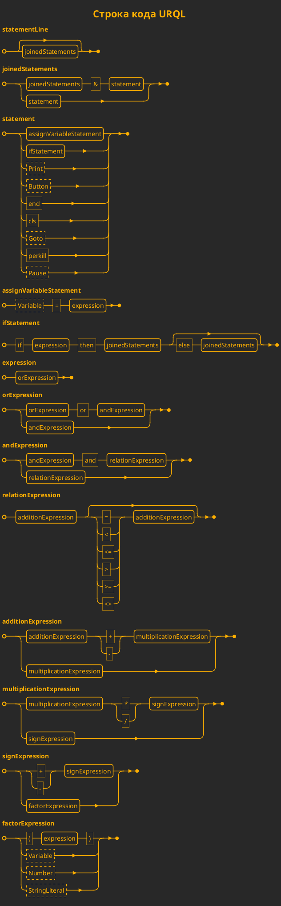

# Адаптация левых рекурсий
$$
A \rightarrow A\alpha \mid A\beta \mid \gamma
$$

преобразуется в:

$$
A \rightarrow \gamma R \newline
R \rightarrow \alpha R \mid \beta R \mid \epsilon
$$

## Адаптация `joinedStatements`
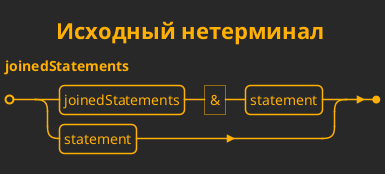

### Разбивка на элементы
| Элемент | Значение  |
|:-------:| --------- |
| $A$ | $joinedStatements$  |
| $\alpha$  | ${'\&'}, statement$ | 
| $\gamma$  | $statement$ |

### Преобразование
| Формула | Результат |
| ------- | --------- |
| $A \rightarrow \gamma R$  | $joinedStatements \rightarrow statement, joinedStatementsRest$  |
| $R \rightarrow {\alpha R} \mid {\beta R} \mid \epsilon$ | $joinedStatementsRest \rightarrow {{'\&'}, statement, joinedStatementsRest} \mid \epsilon$  |

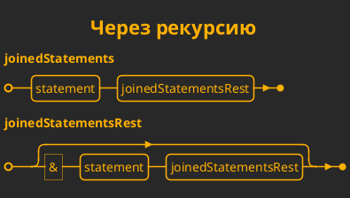

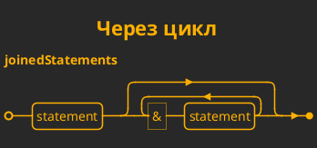

## Адаптация `additionExpression`
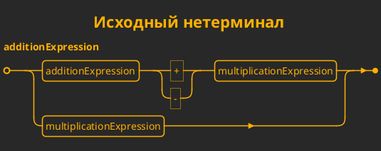

### Разбивка на элементы
| Элемент | Значение  |
|:-------:| --------- |
| $A$ | $additionExpression$  |
| $\alpha$  | ${'+'}, multiplicationExpression$ |
| $\beta$ | ${'-'}, multiplicationExpression$ |
| $\gamma$  | $multiplicationExpression$ |

### Преобразование
| Формула | Результат |
| ------- | --------- |
| $A \rightarrow \gamma R$  | $additionExpression \rightarrow multiplicationExpression, additionExpressionRest$  |
| $R \rightarrow {\alpha R} \mid {\beta R} \mid \epsilon$ | $additionExpressionRest \rightarrow {{'+'}, multiplicationExpression, additionExpressionRest} \mid {{'-'}, multiplicationExpression, additionExpressionRest} \mid \epsilon$  |

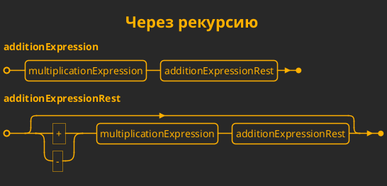

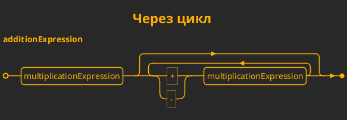

## Адаптация `multiplicationExpression`
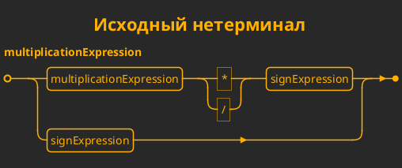

### Разбивка на элементы
| Элемент | Значение  |
|:-------:| --------- |
| $A$ | $multiplicationExpression$  |
| $\alpha$  | ${'*'}, signExpression$ |
| $\beta$ | ${'*'}, signExpression$ |
| $\gamma$  | $signExpression$ |

### Преобразование
| Формула | Результат |
| ------- | --------- |
| $A \rightarrow \gamma R$  | $multiplicationExpression \rightarrow signExpression, multiplicationRest$  |
| $R \rightarrow {\alpha R} \mid {\beta R} \mid \epsilon$ | $multiplicationRest \rightarrow {{'*'}, signExpression, multiplicationRest} \mid {{'/'}, signExpression, multiplicationRest} \mid \epsilon$  |

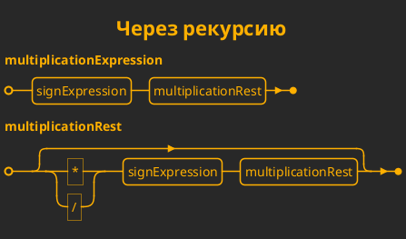

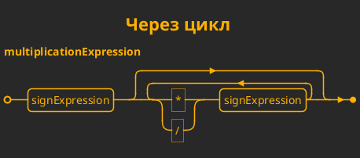

## Адаптация `orExpression`
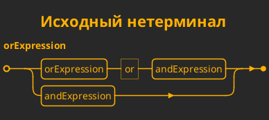

### Разбивка на элементы
| Элемент | Значение  |
|:-------:| --------- |
| $A$ | $orExpression$  |
| $\alpha$  | ${'or'}, andExpression$ |
| $\gamma$  | $andExpression$ |

### Преобразование
| Формула | Результат |
| ------- | --------- |
| $A \rightarrow \gamma R$  | $andExpression \rightarrow andExpression, orExpressionRest$  |
| $R \rightarrow {\alpha R} \mid \epsilon$ | $orExpressionRest \rightarrow {{'or'}, andExpression, orExpressionRest} \mid \epsilon$  |

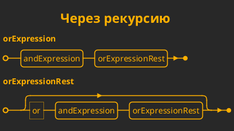

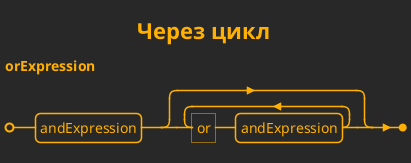